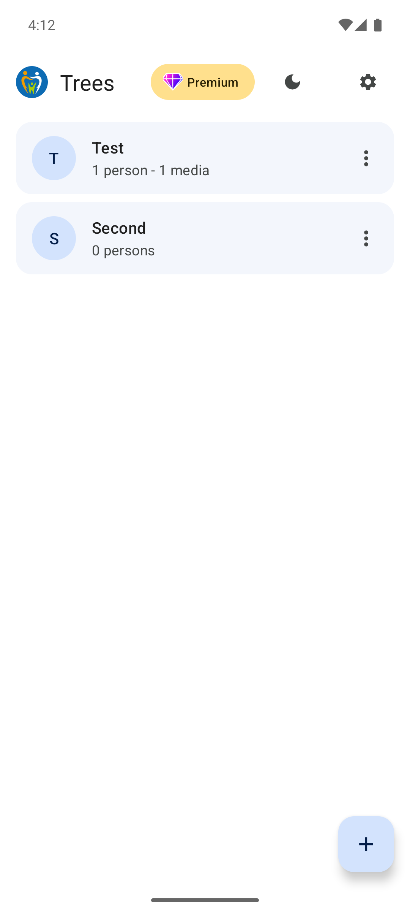
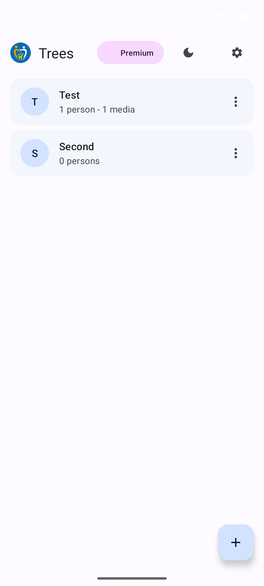
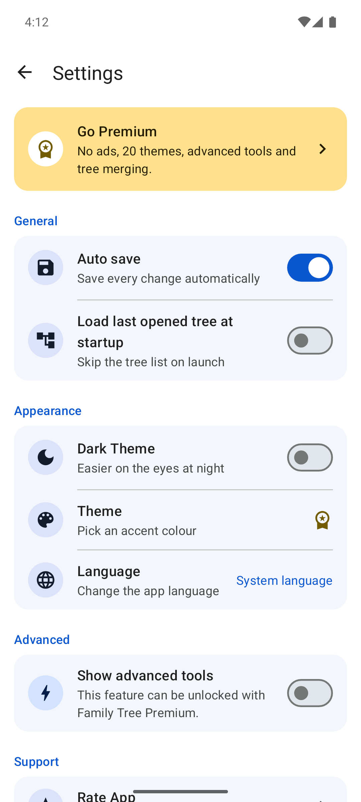
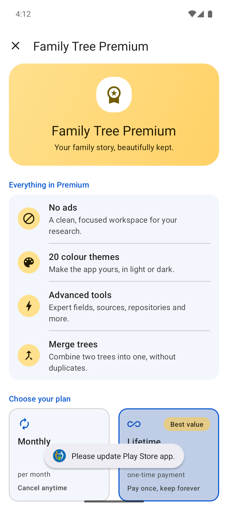

# Family Tree
### _Your family story, beautifully kept._

Family Tree is an open-source Android app for building, exploring and sharing family trees.
It is based on [Family Gem](https://github.com/michelesalvador/FamilyGem) by Michele Salvador and uses the GEDCOM standard,
so your data works in every other genealogy program.

<p>
  
  
  
  
</p>

## Features

**Build your tree**
- Create a tree from scratch with names, dates, places, events, photos, notes and sources.
- Import an existing tree from a GEDCOM (`.ged`) file and edit it freely.
- Export to GEDCOM to use it in any other genealogy program.
- Interactive diagram with left-to-right and right-to-left layouts; export it as PDF or PNG.
- Age at events, date validity hints and grouped relatives (birth, adoptive, foster, half-family).

**Share and merge**
- Share a tree with relatives, receive their updates and choose which ones to accept.
- Merge two trees into one.

**Never miss a moment**
- Birthday notifications at a time you choose.
- Reminders for wedding anniversaries and remembrance days.
- Family places with "Show on map" and directions.

**Keep it safe**
- Manual backup and restore of each tree as a ZIP file; optional automatic backup.
- Media organiser that copies photos and files into app storage.

**Make it yours**
- Material 3 design with light and dark themes and 20 colour themes.
- Translated into 29 languages.

Some features are part of the optional **Premium** plan (monthly or lifetime, through Google Play Billing).
See [docs/specs/premium-features.md](docs/specs/premium-features.md) for exactly what is free and what is Premium.

## Requirements

- Android 7.0 Nougat (API 24) or later; targets Android 17 (API 37).
- Data follows GEDCOM [5.5.1](https://www.familysearch.org/developers/docs/gedcom/) and, where possible,
  [5.5.5](https://www.gedcom.org/gedcom.html), using [Gedcom 5 Java](https://github.com/FamilySearch/gedcom5-java) by FamilySearch.

## Project structure

| Module | What it contains |
|--------|------------------|
| `app` | The application: screens, features (`dna.familytree.feature.*`), resources and translations |
| `core/designsystem` | Brand colours, typography, themes and reusable UI components |
| `core/billing` | Google Play Billing: plans, prices, purchases and entitlement |
| `cropper` | Image cropping library used for profile photos |

More detail: [docs/REBRAND_PLAN.md](docs/REBRAND_PLAN.md) (design, modules, feature notes) and [docs/specs](docs/specs/README.md) (feature specs).

## Building

You need Android Studio (or JDK 17+) and the Android SDK.

```bash
git clone https://github.com/RubanSingh/Family-Tree.git
cd Family-Tree
./gradlew assembleDebug        # or open the project in Android Studio
```

The repository builds out of the box, without any private keys:

| File | In this repository | To use your own |
|------|--------------------|-----------------|
| `app/google-services.json` | **Dummy** config: Firebase (Analytics, Crashlytics, Messaging, Performance) is not connected | Replace it with the file from your own Firebase project for package `dna.familytree` |
| `keystore.properties` | Not included (git-ignored) | Copy `keystore.properties.example` to `keystore.properties` and fill in your keystore and AdMob IDs |

Without `keystore.properties`, release builds (`./gradlew assembleRelease`) are signed with the debug key and use
Google's sample AdMob IDs, so no real ads are requested. Never commit keystores or `keystore.properties`.

## Contributing

Bug reports and pull requests are welcome. Before changing a feature, read its spec in [docs/specs](docs/specs/README.md)
and update it in the same change.

## License

Copyright (C) 2018-2023 Michele Salvador  
Copyright (C) 2023-2026 Digital AI Labs

This program is free software: you can redistribute it and/or modify it under the terms of the GNU General Public License
as published by the Free Software Foundation, either version 3 of the License, or (at your option) any later version.
It is distributed WITHOUT ANY WARRANTY. See [LICENSE.txt](LICENSE.txt) for the full license and [NOTICE](NOTICE) for
copyright, modification and third-party notices.

## Credits

- Original app: [Family Gem](https://github.com/michelesalvador/FamilyGem) by Michele Salvador, an Italian programmer and
  genealogy enthusiast (project started in 2018).
- GEDCOM parsing: [Gedcom 5 Java](https://github.com/FamilySearch/gedcom5-java) by FamilySearch.
- Maintained by Digital AI Labs: [digitalailabs.blogspot.com](https://digitalailabs.blogspot.com) · digitalailabs@gmail.com
